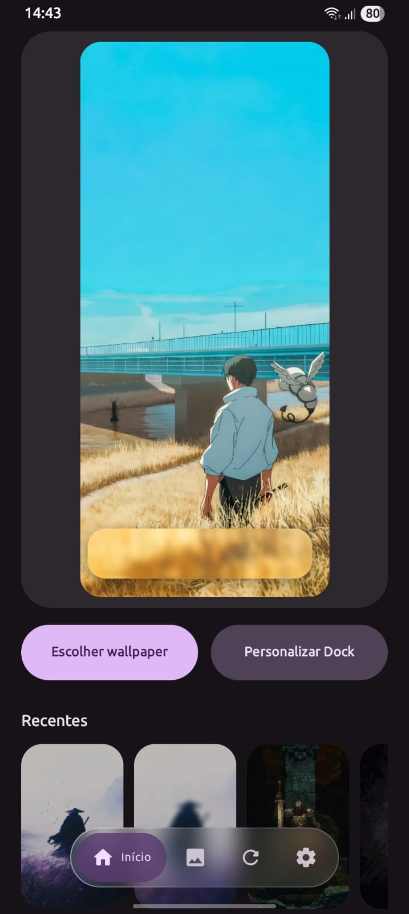
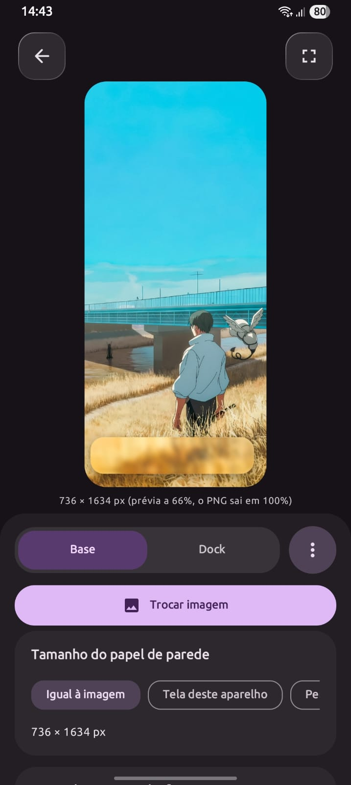
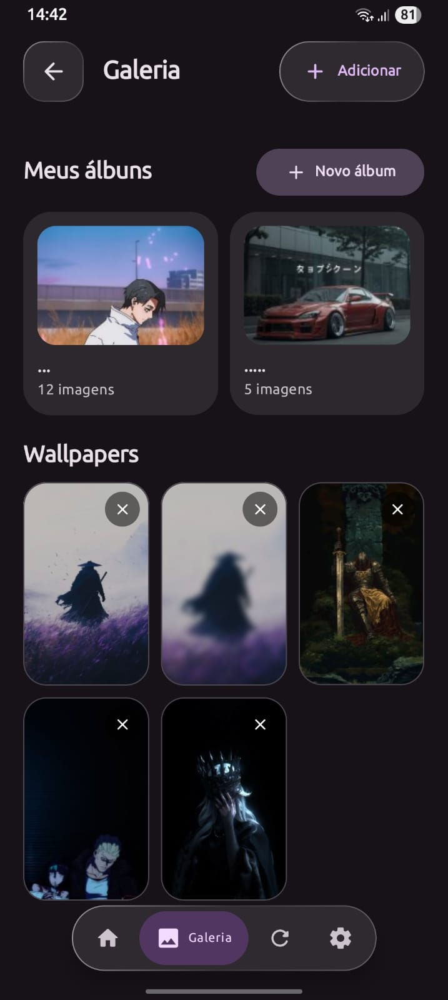
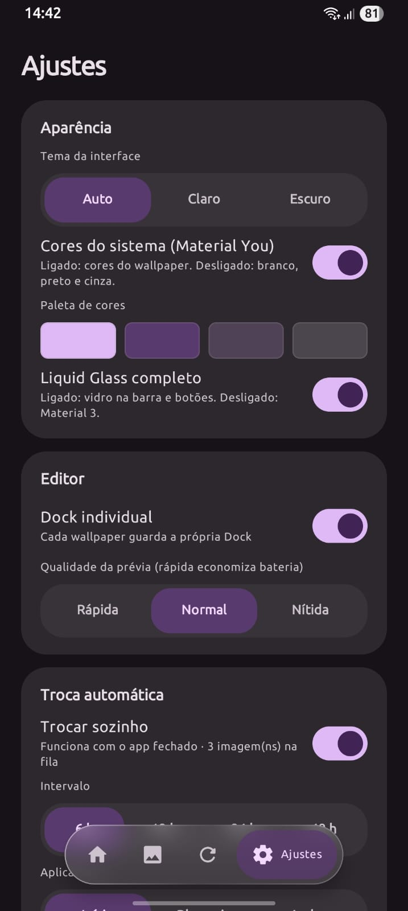

<div align="center">

# 🫧 Dock Líquida

**Personalize seus wallpapers com uma Dock em estilo Liquid Glass.**

Crie, ajuste e aplique wallpapers com uma Dock de vidro, do seu jeito — agora em um aplicativo Android nativo desenvolvido com **Kotlin + Jetpack Compose**.

[](https://www.android.com/)
[](https://kotlinlang.org/)
[](https://github.com/jlian-dev/wallpaper-dockglass/releases)

**[⬇️ Baixar APK](https://github.com/jlian-dev/wallpaper-dockglass/releases)** · **[🌐 Site oficial](https://jlian-dev.github.io/dock-liquida-site/)** · **[🐛 Relatar problema](https://github.com/jlian-dev/wallpaper-dockglass/issues)**

</div>

---

## ✨ Seu wallpaper, sua Dock

O **Dock Líquida** é um aplicativo de personalização de wallpapers para Android. Ele permite criar uma Dock com aparência de vidro líquido, ajustar seu formato e posicionamento e combinar o resultado com diferentes imagens. O foco é a experiência de personalização da Dock — não um editor de imagens genérico.

> **Importante:** a Dock é composta ao wallpaper. O aplicativo não substitui a Dock de ícones do launcher nem altera a interface do sistema Android.

## 📱 Capturas do aplicativo

> **Espaço reservado para as suas imagens.** Coloque os arquivos em `assets/screenshots/` e descomente o bloco HTML logo abaixo no `README.md`. Você pode usar as mesmas capturas no site oficial.

<!-- INÍCIO DAS CAPTURAS — remova esta linha e a linha de encerramento quando tiver enviado as imagens.
<div align="center">
  
  
  
  
</div>
FIM DAS CAPTURAS -->

**Arquivos esperados:** `inicio.png` · `editor.png` · `galeria.png` · `ajustes.png`  
*Dica: capture a tela sem notificações pessoais e mantenha proporções semelhantes para um resultado uniforme.*

## 🧩 Funcionalidades

| Recurso | O que permite fazer |
| --- | --- |
| 🫧 **Liquid Glass** | Personalizar a Dock com refração, brilho, bordas e acabamentos de vidro. |
| 🎛️ **Editor em tempo real** | Ajustar dimensões, curvatura, posição e enquadramento sobre o wallpaper. |
| 📐 **Alinhamento na tela inicial** | Ajustar a posição da Dock usando uma sobreposição sobre o launcher, quando permitido pelo Android. |
| 🗂️ **Galerias e álbuns** | Organizar imagens nas galerias Fixa e Automática, com álbuns e movimentação de wallpapers. |
| 🔁 **Troca automática** | Alternar wallpapers conforme as opções configuradas no aplicativo. |
| 🎨 **Material You opcional** | Usar as cores dinâmicas do Android ou uma paleta neutra; com tema claro/escuro. |
| 💾 **Backup manual `.dckl`** | Exportar e restaurar imagens e configurações em um arquivo compactado. |
| 🧠 **Detecção de duplicatas** | Evitar a importação repetida de arquivos de imagem idênticos. |

> Alguns recursos podem variar entre versões estáveis e betas. Consulte as notas da Release correspondente antes de instalar.

## ⬇️ Download e instalação

1. Acesse a página de **[Releases](https://github.com/jlian-dev/wallpaper-dockglass/releases)** ou o **[site oficial](https://jlian-dev.github.io/dock-liquida-site/)**.
2. Selecione a versão desejada e baixe o arquivo **APK**.
3. Abra o APK no Android e autorize a instalação por essa fonte, se o sistema solicitar.
4. Inicie o Dock Líquida e conceda apenas as permissões necessárias para as funções que utilizar.

**Versão estável ou beta?** Prefira a versão estável para uso diário. Betas são destinadas a testes e podem apresentar problemas.

> ⚠️ **Atualizações da versão antiga (Capacitor) para a versão nativa:** antes de instalar uma versão nova sobre a antiga, confira nas notas da Release se há compatibilidade de dados e assinatura. Faça backup das personalizações importantes.

## 🛠️ Para desenvolvedores

O projeto Android nativo utiliza **Kotlin**, **Jetpack Compose** e APIs do Android. Os componentes principais são organizados por responsabilidade:

```text
app/src/main/java/com/dockliquida/app/
├── data/      # Biblioteca de wallpapers, álbuns e preferências
├── glass/     # Renderização do efeito Liquid Glass
├── render/    # Preparação e enquadramento das imagens
├── system/    # Recursos do Android e tarefas automáticas
└── ui/        # Telas e componentes Jetpack Compose
```

### Compilar localmente

**Requisitos:** Android Studio, Android SDK compatível com o projeto e JDK 17.

```bash
# Linux/macOS
./gradlew :app:assembleDebug
```

```powershell
# Windows / PowerShell
.\gradlew.bat :app:assembleDebug
```

O APK de teste é gerado em `app/build/outputs/apk/debug/`.

> A estrutura acima corresponde ao projeto **nativo**. Se a branch consultada ainda tiver arquivos `www/`, `capacitor.config.json` ou `package.json`, ela contém código da versão anterior e exige outro processo de compilação.

## ❓ Perguntas frequentes

**Preciso de um launcher específico?**  
Não para criar e aplicar wallpapers com a Dock desenhada na imagem. O posicionamento visual pode variar conforme o launcher, o tamanho da grade e os ícones.

**O aplicativo modifica a Dock real do Android?**  
Não. A personalização é renderizada no wallpaper; o launcher mantém seus próprios ícones e sua própria Dock.

**Por que o Android pede permissão para instalar o APK?**  
Porque o arquivo foi baixado fora de uma loja de aplicativos. Autorize apenas a fonte em que você confia.

**Posso guardar minhas configurações?**  
Nas versões que incluem o recurso, a seção Ajustes permite criar e restaurar um backup manual `.dckl`.

## 💬 Acompanhe o projeto

- **[Site oficial](https://jlian-dev.github.io/dock-liquida-site/)** — apresentação do aplicativo e acesso às versões.
- **[GitHub Releases](https://github.com/jlian-dev/wallpaper-dockglass/releases)** — APKs e histórico de mudanças.
- **[Issues](https://github.com/jlian-dev/wallpaper-dockglass/issues)** — bugs e sugestões.

---

<div align="center">

Feito com Kotlin, Android e muitas horas ajustando o vidro. 🫧

**Dock Líquida — personalize a Dock, transforme seu wallpaper.**

</div>
